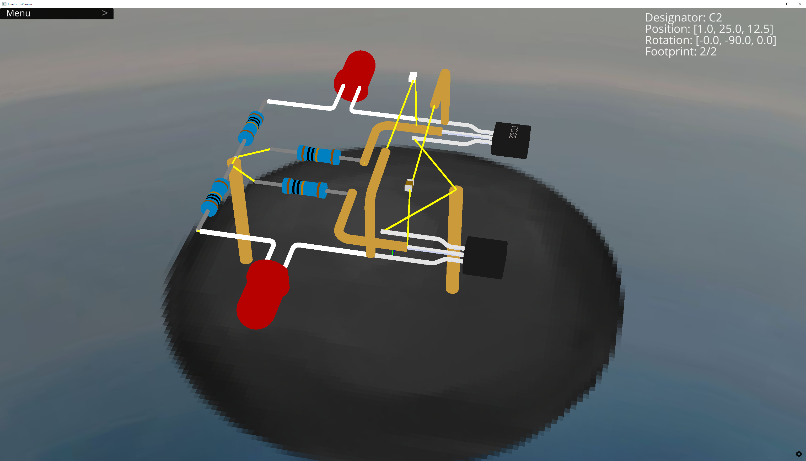
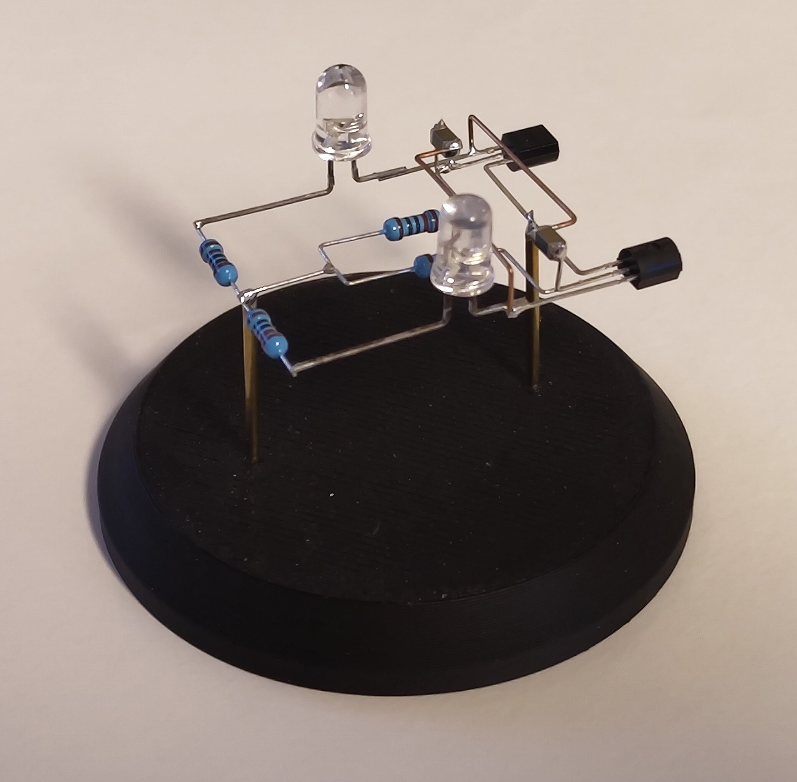

# Freeform-Planner

**Freeform-Planner** is an interactive 3D layout tool for planning freeform/point-to-point electronic circuits. Draw a schematic, place the components in 3D space and follow the airwires until everything is connected.



*Example: a two-transistor LED blinker with components placed in 3D space and airwires showing all net connections. The project is included as an example.*

> **Version 2.0 (in development, branch `v2-web`)** is a browser app with its own schematic and library editor, so KiCad is no longer needed. It lives in [`app/`](app/). The v0.1.x Python app (KiCad netlist import) is still in the repository root and is described [further below](#v01x-python-app).

---

## 2.0: browser app

### Workflow

1. **Schematic** (F1): pick parts from the library list, connect pins with wires, net labels or power symbols.
2. **3D Layout** (F2): parts appear on a staging grid as soon as they are placed in the schematic. Arrange them; yellow airwires show what still has to be connected (minimum spanning tree per net). Insert freeform wires on airwires.
3. **Library** (F3): create symbols, footprints (import an OBJ/MTL model and click on it to place pin anchors) and parts that link a symbol to one or more footprint variants.
4. **Save** (Ctrl+S) writes a `.ffp.json` project. Projects contain copies of the parts they use, so they open the same way on any machine. Unsaved work is also kept in the browser.

| 3D layout action | Keys |
|---|---|
| Select | Left click (Shift/Ctrl adds) |
| Translate X / Y / Z | `6` / `4` — `9` / `1` — `8` / `2` |
| Rotate X / Y / Z | `W` / `S` — `D` / `A` — `E` / `Q` |
| Reset rotation | `R` |
| Next footprint variant | `F` |
| Insert freeform wire | select an airwire, then `I` (was Ctrl+W, which browsers reserve) |
| Remove freeform wire | `Del` |
| Gizmo move / rotate | `T` / `G` |
| Orbit / pan / zoom | right drag / middle drag / wheel |
| Frame all | `Home` |
| SpaceMouse | Chromium browsers (WebHID): “Connect SpaceMouse” once |

All keys are configurable under *Edit ▸ Settings*. Press `?` in the app for the full list, including the schematic shortcuts.

### Development

Requires Node.js 24.

```sh
cd app
npm ci
npm run dev          # development server
npm run check        # everything CI runs: typecheck, lint, unit tests, build, end-to-end tests
```

| Command | What it does |
|---|---|
| `npm test` | unit tests (Vitest) |
| `npm run coverage` | unit tests with coverage thresholds for `src/core` |
| `npm run e2e` | Playwright tests against the production build in Chromium, Firefox and WebKit |
| `npm run e2e:update` | update screenshot baselines (review the image diff before committing) |

First time only: `npx playwright install` downloads the browsers.

### Architecture

```
app/src/core/        pure TypeScript, no DOM/React/Three.js (enforced by tsconfig + lint)
                     data model + schemas, netlist derivation, airwires, edit commands,
                     undo history, file format + migrations, OBJ writer
app/src/schematic/   SVG schematic editor
app/src/layout3d/    Three.js 3D layout, model loading, SpaceMouse (WebHID)
app/src/library-ui/  symbol, footprint and part editors
app/src/app/         shell: store, menus, files, autosave, settings
app/src/library/     built-in library (JSON)
app/fixtures/        golden corpus: files of every released format version
tools/               one-off converters from v0.1.x
```

- **The project data is the single source of truth.** Views only render it; every edit is a pure function `project → project`, which also gives undo/redo.
- **The netlist is derived** from the schematic (wires, junctions, labels, power symbols) every time, so the 3D layout always matches the schematic.
- **Coordinates:** 3D is right-handed, Y up, millimetres (same as Three.js). The schematic uses a 1.27 mm grid with y pointing down.

### How releases are kept safe

- CI runs on every push and pull request. It typechecks, lints, runs the unit tests with coverage thresholds, builds the app, then runs the end-to-end tests in three browsers against that exact build. Each run uploads the build as an artifact you can download and try.
- **Golden corpus:** `app/fixtures/` holds project files of every released format version. Every build must still load them, and the v0.1.1 example must produce the same airwires the Python version computed.
- **Screenshot tests** catch rendering changes. Baselines are stored per platform under `app/tests/e2e/__screenshots__/`. The first CI run on Linux uploads the missing baselines as the `screenshot-baselines-linux` artifact; commit them to make the comparison strict.
- **Release:** pushing a tag `vX.Y.Z` that matches `app/package.json` reruns everything, including the full end-to-end suite, on the release build. Only then does it publish the zip to GitHub Releases and deploy to GitHub Pages. To enable Pages, set *Settings ▸ Pages ▸ Source* to “GitHub Actions”.
- Format changes need a migration in `src/core/fileFormat.ts` and a new fixture. Bug fixes come with a regression test.

### Opening v0.1.x projects

Convert the pickled `.ffps` file once, then open the resulting `.json` in the app:

```sh
python tools/convert_legacy.py project my-project.ffps my-project.json
```

The schematic is generated: one net label per connected pin, carrying the old net names. Positions, rotations, footprint choices and freeform wires are kept.

---

## v0.1.x Python app

### 1 — Draw a schematic in KiCad
Open KiCad and use the included library to draw your circuit.

### 2 — Export a netlist from KiCad
In the schematic → **File ▸ Export ▸ Netlist…** → choose the **KiCad** format and save the `.net` file.

### 3 — Open the layout
Start Freeform-Planner (`Planner.py` or the built exe) and use **Menu ▸ Load** to open either a `.net` KiCad netlist or a `.ffps` project file.

### 4 — Place components
| Action | Keys |
|---|---|
| Translate X / Y / Z | `6` / `4` — `9` / `1` — `8` / `2` |
| Rotate X / Y / Z | `W` / `S` — `D` / `A` — `E` / `Q` |
| Reset rotation | `R` |
| Cycle through footprints | `F` |
| Insert/Remove wire | `Ctrl + W` |
| Orbit / pan / zoom | right drag / middle drag / wheel |

#### SpaceMouse navigation (optional)
A connected 3Dconnexion SpaceMouse is picked up automatically at startup through [pyspacemouse](https://github.com/JakubAndrysek/PySpaceMouse). On Windows it needs the native `hidapi.dll` ([hidapi releases](https://github.com/libusb/hidapi/releases), x64 build) next to `python.exe`, on your `PATH`, or in the project root for the exe build. Linux needs `libhidapi` plus udev access. Speeds, deadzone and the reset button live in `settings.py`.

### 5 — Save your work
**Menu ▸ Save** writes a `.ffps` project file.

### Setup (uv)
1. `pip install uv`
2. In the project root: `uv sync`
3. Run: `python Planner.py`. Tests: `pytest -q`

---

## Disclaimer
I've used AI (Copilot, Claude) extensively to get this project to a useable state.
That point in time is clearly visible in the commit logs.
