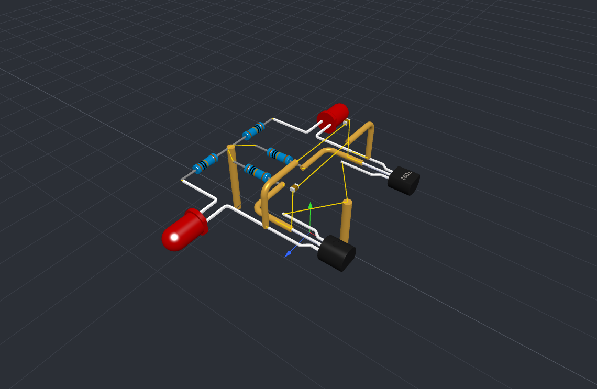
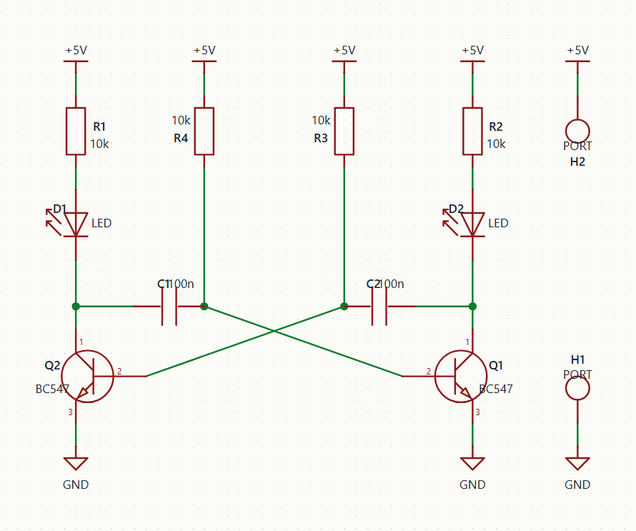

# Freeform-Planner

**Freeform-Planner** is a browser app for planning freeform / point-to-point electronic circuits. Draw a schematic, place the components in 3D space and follow the airwires until everything is connected.

**[Open the app](https://lbarbisch.github.io/Freeform-Planner/)** · [Download a release](https://github.com/lbarbisch/Freeform-Planner/releases)





<!-- Photo of the finished blinker: add docs/built-blinker.jpg, then remove this comment's markers.

-->

*Example: a two-transistor LED blinker. Open it in the app with **File ▸ Open example**.*

---

## Workflow

1. **Schematic** (F1): pick parts from the library list and connect pins with wires, net labels or power symbols.
2. **3D Layout** (F2): parts appear on a staging grid as soon as they are placed in the schematic. Arrange them; yellow airwires show what still has to be connected (minimum spanning tree per net). Turn airwires into wires as you go.
3. **Library** (F3): create symbols, footprints (import an OBJ/MTL model and click on it to place pin anchors) and parts that link a symbol to one or more footprint variants.
4. **Save** (Ctrl+S) writes a `.ffp.json` project. Projects contain copies of the parts they use, so they open the same way on any machine. Unsaved work is also kept in the browser.

### 3D layout

| Action | Keys |
|---|---|
| Select | Left click (Shift/Ctrl adds) |
| Translate X / Y / Z | `6` / `4` — `9` / `1` — `8` / `2` |
| Rotate X / Y / Z | `W` / `S` — `D` / `A` — `E` / `Q` |
| Reset rotation | `R` |
| Next footprint variant | `F` |
| Insert wire | select an airwire, then `I` |
| Remove wire | `Del` |
| Gizmo move / toggle move–rotate | `T` / `G` |
| Orbit / pan / zoom | right drag / middle drag / wheel |
| Frame all | `Home` |
| SpaceMouse | Chromium browsers (WebHID): “Connect SpaceMouse” once |

### Schematic

| Action | Keys |
|---|---|
| Wire tool / net label / back to select | `W` / `L` / `Esc` |
| Rotate / mirror / delete | `R` / `X` / `Del` |
| Wire corner direction | `/` |
| Move | drag (connected wires follow) |
| Box select | drag on empty space |
| Pan / zoom / fit | right or middle drag / wheel / `Home` |
| Edit reference or label | double-click |

Undo / redo with Ctrl+Z / Ctrl+Y. The 3D layout keys and step sizes are configurable under *Edit ▸ Settings*; press `?` in the app for the full list.

### Opening v0.1.x projects

v0.1.x was a Python app that imported KiCad netlists and saved pickled `.ffps` files. To open such a project, convert it once with [`tools/convert_legacy.py`](https://github.com/lbarbisch/Freeform-Planner/blob/1db7ecdab07c903b90681c81f6830689cbfbe8ba/tools/convert_legacy.py) from the last commit that still contained it, then open the resulting `.json` in the app:

```sh
python tools/convert_legacy.py project my-project.ffps my-project.json
```

The schematic is generated: one net label per connected pin, carrying the old net names. Positions, rotations, footprint choices and wires are kept.

The Python app itself is available from the [v0.1.1 release](https://github.com/lbarbisch/Freeform-Planner/releases/tag/v0.1.1).

---

## Development

Requires Node.js 24. Everything lives in [`app/`](app/).

```sh
cd app
npm ci
npx playwright install   # first time only: browsers for the end-to-end tests
npm run dev              # development server
npm run check            # everything CI runs: typecheck, lint, unit tests, build, end-to-end tests
```

| Command | What it does |
|---|---|
| `npm test` | unit tests (Vitest) |
| `npm run coverage` | unit tests with coverage thresholds |
| `npm run e2e` | Playwright tests against the production build in Chromium, Firefox and WebKit |
| `npm run e2e:update` | update screenshot baselines (review the image diff before committing) |

### Architecture

```
app/src/core/        pure TypeScript, no DOM/React/Three.js (enforced by tsconfig + lint)
                     data model + schemas, netlist derivation, airwires, edit commands,
                     undo history, file format + migrations, OBJ writer
app/src/schematic/   SVG schematic editor
app/src/layout3d/    Three.js 3D layout, model loading, SpaceMouse (WebHID)
app/src/library-ui/  symbol, footprint and part editors
app/src/app/         shell: store, menus, files, autosave, settings
app/src/library/     built-in library (JSON)
app/public/          3D models and the example project
app/fixtures/        golden corpus: files of every released format version
app/tests/e2e/       Playwright end-to-end and screenshot tests
```

- **The project data is the single source of truth.** Views only render it; every edit is a pure function `project → project`, which also gives undo/redo.
- **The netlist is derived** from the schematic (wires, junctions, labels, power symbols) every time, so the 3D layout always matches the schematic.
- **Coordinates:** 3D is right-handed, Y up, millimetres (same as Three.js). The schematic uses a 1.27 mm grid with y pointing down.

### How releases are kept safe

- **CI** runs on every push and pull request: typecheck, lint, unit tests with coverage thresholds, build, then the end-to-end tests in three browsers against that exact build. Each run uploads the build as an artifact you can download and try.
- **Golden corpus:** `app/fixtures/` holds project files of every released format version. Every build must still load them, and the v0.1.1 example must produce the same airwires the Python version computed.
- **Example project:** `app/public/examples/` must load without warnings and save back unchanged.
- **Screenshot tests** catch rendering changes. Baselines are stored per platform under `app/tests/e2e/__screenshots__/`. The first CI run on Linux uploads missing baselines as the `screenshot-baselines-linux` artifact; commit them to make the comparison strict.
- **Release:** push a tag `vX.Y.Z`. CI builds the tag with that version (shown in Help ▸ About); `app/package.json` does not need to be changed. Once CI has passed on that tag, the release workflow publishes exactly the tested build as a zip on GitHub Releases and deploys it to GitHub Pages.
- Format changes need a migration in `app/src/core/fileFormat.ts` and a new fixture. Bug fixes come with a regression test.

---

## Disclaimer
I've used AI (Copilot, Claude) extensively to get this project to a usable state.
That point in time is clearly visible in the commit logs.
